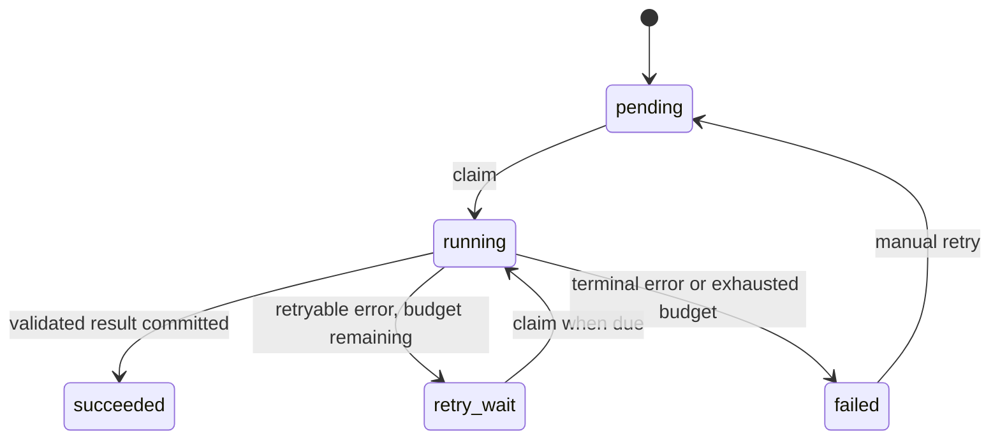

# Worker state machine

## Guarantees

- Atomic claim increments attempts, records owner and lease expiry.
- A second worker cannot claim an unexpired running task.
- Ownership is checked before completing or failing a task.
- A heartbeat renews leases during long operations.
- Crash recovery moves expired running tasks to retry_wait or failed.
- No worker loops over future-dated retries, so unresolved links cannot cause infinite busy loops.
- A completed report is never reset to pending by rediscovery.
- Manual retry explicitly resets budget; it never runs implicitly on terminal errors.

## HTTP error classification

Connection errors, timeouts, 429 and 5xx are retryable. 401, 403, 404, 410, untrusted URLs, bad file signatures and rejected ZIP entries are terminal. Site HTML selector changes raise ParseError rather than being interpreted as the end of a category.

## Paging

Checkpoint next_page is updated after every successful page. Completed categories have (next_page=1, complete=true). --resume continues unfinished categories; --incremental intentionally starts again at page 1 and upsert preserves existing work.
